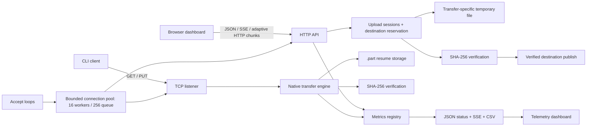

# Архитектура Adaptive TCP v5.2

Система разделена на транспортный слой (`socket.*`), нативный движок передачи
(`transfer.*`), вычисление SHA-256 (`sha256.*`), мониторинг (`metrics.*`),
сервер/клиент и статический web-интерфейс. Серверные соединения обрабатываются
ограниченным пулом рабочих потоков; очередь соединений также ограничена.

## Нативный TCP GET/PUT

GET и PUT используют собственный протокол: текстовая команда содержит путь,
размер, смещение, начальный размер блока и хеш (для PUT). Каждый блок начинается
с 64-битной big-endian длины. Отправитель изменяет размер следующих блоков на
основе измеренных окон пропускной способности и проб при стабильной скорости.
Получатель записывает фактический размер принятого кадра в телеметрию. PUT
использует `.part` для возобновления и проверяет SHA-256 до публикации файла.

## Браузерная передача

Панель регистрирует передачу через `POST /api/upload/init`, затем вычисляет
SHA-256 в браузере и отправляет файл последовательностью `POST
/api/upload/chunk`. Каждый запрос содержит один прикладной блок и точное
смещение. Начальный размер 64 KiB; клиент адаптирует последующие блоки в
диапазоне 4 KiB–4 MiB. Сервер проверяет смещение и размер, записывает блок в
уникальный временный файл, сохраняет фактический размер и скорость в метриках,
проверяет SHA-256 и публикует файл только при совпадении хеша.

## Мониторинг и экспорт

`metrics.*` хранит последние 100 передач, выборки измерений и журнал событий.
Накопительные счётчики переданных байтов и завершённых передач не зависят от
ограниченной истории. Панель использует `/api/status`, `/api/events` (SSE) и
`/api/about`; `GET /api/export/metrics.csv` выгружает сохранённые измерения.

## Конкурентная запись и остановка

Процесс резервирует целевой путь на время записи. Это предотвращает одновременную
запись нескольких HTTP/TCP-передач в один файл. Временные HTTP-файлы уникальны
для transfer ID. При остановке сервер закрывает слушатели, прерывает активные
сокеты и присоединяет рабочие потоки пула.

## Границы доверия

Оба слушателя по умолчанию привязаны к loopback. Проверка путей блокирует
абсолютные пути, `..` и существующие symlink-компоненты, но не устраняет TOCTOU
полностью. Передача не зашифрована и не аутентифицирована; подробности и
ограничения перечислены в [security.md](security.md).
