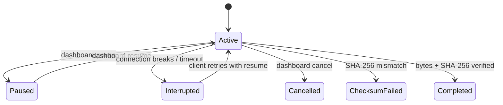

# State machine

`Completed` допускается только после подтверждения полного размера и SHA-256.
Незавершённые данные остаются во временном `.part` файле и не должны считаться
готовым целевым файлом.
